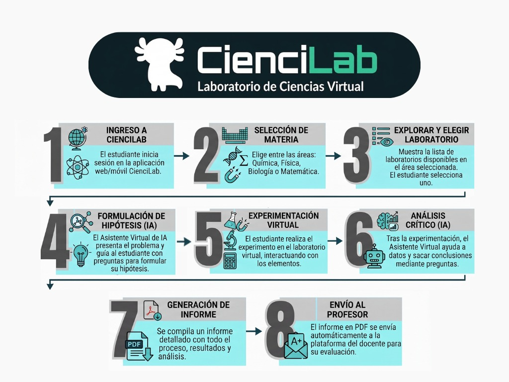
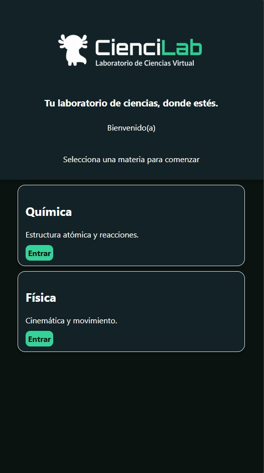
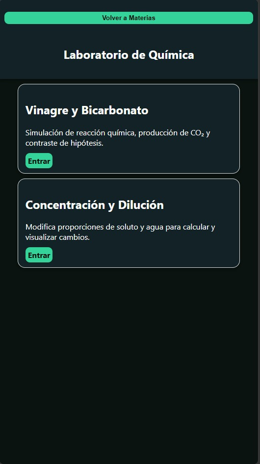
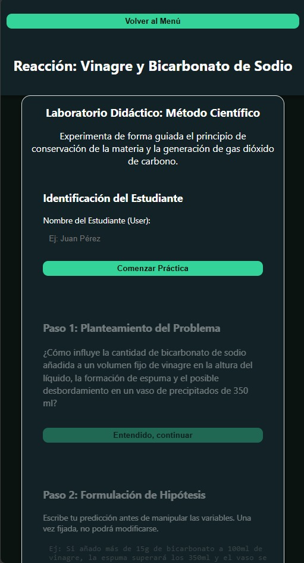

#  CienciLab – Laboratorio Virtual de Ciencias

Aplicación web didáctica (HTML, CSS y JavaScript puro) que permite realizar prácticas de **Química** y **Física** de forma guiada, siguiendo el **método científico**, desde cualquier dispositivo y sin necesidad de instalar nada.

> **Lema:** *Tu laboratorio de ciencias, donde estés.*

 **Demo en línea:** `https://miriamgisela06-commits.github.io/laboratorio-CienciLab/`

---

##  Descripción

CienciLab simula experimentos de laboratorio que el estudiante puede completar paso a paso: identificarse, plantear una hipótesis, experimentar con variables, registrar observaciones, analizar resultados, un asistente IA de razonamiento científico que analiza las hipótesis y conclusiones de las estudiantes y les ofrece orientación personalizada  y **exportar una ficha de laboratorio en formato PDF/Word (.doc)**.

## Prácticas disponibles

| Materia | Práctica | Descripción |
|---|---|---|
|  Química | **Vinagre y Bicarbonato** | Simulación de la reacción ácido-base y producción de CO₂. Se ajustan el volumen de vinagre y la masa de bicarbonato, y se contrasta la hipótesis con el resultado. |
|  Química | **Concentración y Dilución** | Calculadora interactiva: al modificar la masa de soluto (g) y el volumen de agua (L) se calcula la concentración en g/L. |
|  Física | **Cinemática (MRU)** | Simulación del Movimiento Rectilíneo Uniforme con animación en `canvas`; relaciona distancia, tiempo y velocidad. |
|  Física | MRUV y Aceleración | *Próximamente.* |

##  Flujo de cada práctica (método científico)

1. Identificación del estudiante
2. Planteamiento del problema
3. Formulación de hipótesis
4. Experimentación (simulación interactiva)
5. Observación de resultados
6. Análisis crítico
7. Conclusión y exportación de la **ficha de laboratorio** (Word)

##  Diagrama del flujo de CienciLab

Diagrama general del diseño de la aplicación, desde el ingreso del estudiante hasta la entrega del informe al docente.



##  Capturas de pantalla

### Pantalla de inicio
Selección de la materia (Química o Física).



### Menú de Química
Prácticas disponibles en el laboratorio de Química.



### Práctica: Vinagre y Bicarbonato
Identificación del estudiante, planteamiento del problema y formulación de hipótesis.



##  Estructura del proyecto

```
.
├── index.html          # Página de inicio (selección de materia)
├── styles.css          # Estilos globales (tema oscuro)
├── sw.js               # Service Worker (caché para uso sin conexión)
├── logo.png            # Logo de la aplicación
├── img/                # Diagrama y capturas de pantalla del README
├── quimica/
│   ├── index.html      # Menú de prácticas de Química
│   ├── bicarbonato.html
│   └── dilucion.html
└── fisica/
    ├── index.html      # Menú de prácticas de Física
    └── mru.html
```

##  Cómo ejecutarlo

**Opción 1 – Abrir directamente:** descarga o clona el repositorio y abre `index.html` en tu navegador.

**Opción 2 – Servidor local** (recomendado, necesario para el Service Worker):

```bash
# con Python
python -m http.server 8000
# luego abre http://localhost:8000
```

**Opción 3 – GitHub Pages:** visita el enlace de la demo indicado arriba.

##  Tecnologías

- HTML5 y CSS3 (diseño responsivo, tema oscuro)
- JavaScript (sin librerías externas)
- `<canvas>` para las animaciones de los experimentos
- Service Worker para caché offline
- Exportación de reportes a Word mediante HTML con formato Office

##  Autores

- **Sofía Romao y Noah Morales** – sofia.romao@utp.edu.pa noah.morales@utp.ac.pa
- Institución: Universidad Técnologica de Panamá/UTP/Sede de Santiago Veraguas
- Docente / Facilitador: Eric Prez

##  Licencia

Proyecto con fines educativos. Puedes agregar una licencia (por ejemplo, MIT) desde GitHub: *Add file → Create new file → `LICENSE`*.
